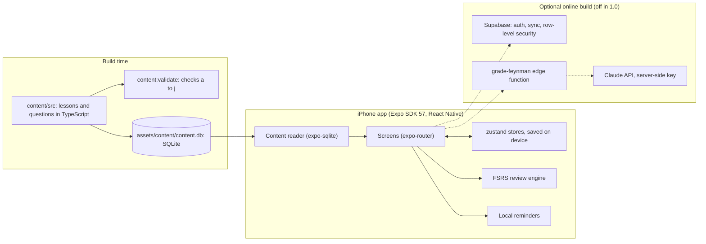

# Claude Learners

Live demo: https://claude-learner.vercel.app

Short daily lessons, spaced review and full mock exams for the Claude Certified Architect Foundations (CCA-F) exam, on iPhone.

## Why it exists

The CCA-F exam covers five weighted domains, from agentic architecture to context management, and the public exam guide says exactly how much each one counts. Claude Learners turns that guide into a daily habit: a few minutes a day, questions weighted like the real thing, and review that brings your mistakes back until they stick.

It also measures honestly. Every exam form is checked so that no answer can be found by its shape: in an earlier version, always picking the longest option passed every mock exam. Now that strategy scores below chance, and a validator keeps it that way.

## Features

- **58 lessons** across the 5 exam domains, each designed to take under 5 minutes.
- **649 original questions**, split across the domains in the same proportions as the public exam guide's weights.
- **3 full mock exams** (60 questions, 120 minutes) and **5 domain mini exams** (18 questions, 25 minutes), with a report by domain and by task, and what to study next.
- **Spaced review** (FSRS): missed questions come back on a schedule. Lesson misses always keep seats in a session, even after a hard mock.
- **Explain it back**: put each idea in your own words, then check yourself against the key points.
- **A source on every answer**: each explanation links to the public documentation it is based on.
- **Streaks, XP and gentle local reminders**, with quiet hours and kind, pressure-free wording.
- **Accessible**: VoiceOver labels and announcements, Dynamic Type, Reduce Motion.
- **Private**: version 1.0 has no account, no analytics and no tracking. Progress stays on the iPhone. See [docs/privacy.md](docs/privacy.md).

## Architecture



The content is compiled into a SQLite file that ships inside the app, so lessons and exams work offline. The optional backend turns on only in builds that set `EXPO_PUBLIC_SUPABASE_URL` and `EXPO_PUBLIC_SUPABASE_KEY`; the API key for explain-back grading stays in the edge function, with a per-learner daily limit and an app-wide daily cap.

## How to run

Requirements: Node 22, Xcode with an iOS Simulator, CocoaPods. Docker only for the Supabase-backed tests.

```bash
npm ci
npx expo run:ios            # build and open in the iOS Simulator
npm run typecheck && npm run lint
npx jest --selectProjects expo
npm run content:validate    # every content check, including the answer-length cue gate
```

Release build (App Store, local-only): leave `EXPO_PUBLIC_SUPABASE_URL` and `EXPO_PUBLIC_SUPABASE_KEY` unset, run `npm run release:check` and `npx expo prebuild --platform ios`, then archive `ios/ClaudeLearners.xcworkspace` in Xcode.

The whole contract: `bash evals/run.sh` checks the 17 criteria in `.engineering/GOAL.md` and writes `evals.json`. The Supabase-backed criteria need a local stack first: export Cloudflare's public Turnstile test secret, `TURNSTILE_SECRET_KEY=1x0000000000000000000000000000000AA` (the same value CI uses), then run `npm run supabase:start` (Docker).

## Data sources and terms

Questions cite public sources only: Anthropic's documentation (platform.claude.com, code.claude.com and anthropic.com), the Model Context Protocol documentation (modelcontextprotocol.io), and the public [CCA-F exam guide](https://anthropic-partners.skilljar.com/claude-certified-architect-foundations-certification). `content/official-task-statements.md` condenses the exam guide's task statements; that text remains Anthropic's.

Every question is original, written from those public materials. None is a real exam question, and nothing here comes from content covered by the exam's confidentiality terms.

## Known limits

- iPhone only. There is no web or Android release.
- Version 1.0 is local-only: no accounts, no sync between devices, and explain-back is a self-check. The online backend exists in the code but is not deployed.
- The exam forms pass the answer-length gate, but the lesson bank still has the old cue: in lessons, the longest option is usually the right one. Rewriting those distractors is next.
- The app's exam score is an estimate on the 100 to 1000 scale. It is not the official scaled score.
- VoiceOver behavior has been checked in code and tests, not yet by ear on a device.

## Affiliation

Independent project. Not affiliated with Anthropic.

## License

MIT. See [LICENSE](LICENSE).
